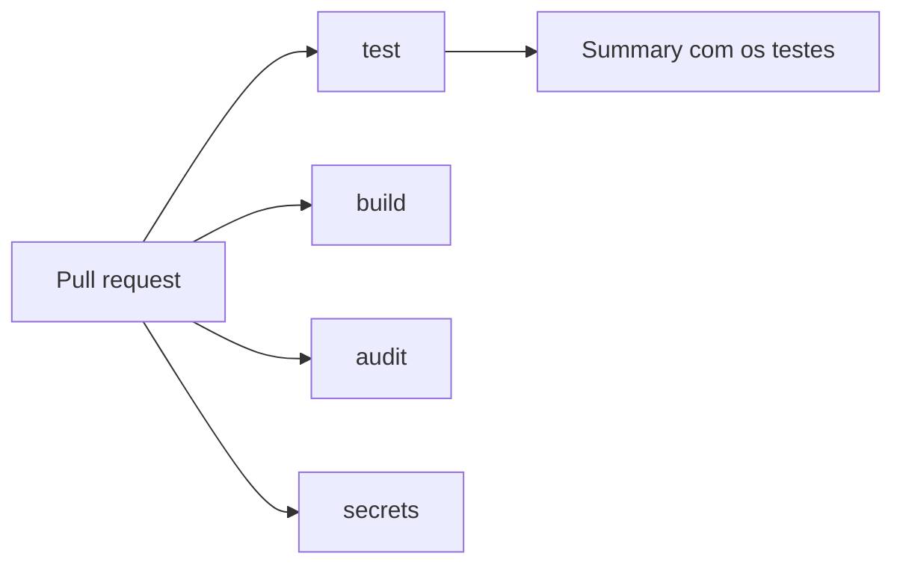

# Changelog

O histórico segue o que já está na `main`. Datas no formato AAAA-MM-DD.

## [Não publicado]

Nada aguardando publicação além do que está na `main`.

## [2026-10-26]

### Adicionado

- CI no GitHub Actions, disparado em pull request e nas branches `develop` e `main`.
- Testes unitários do formulário de pitch (`mapFormToGamePitch`) e dos formatadores do dashboard.
- Resumo da validação na aba Summary do check `test`.
- Modelo de pull request em português (`.github/PULL_REQUEST_TEMPLATE.md`).
- Selo de CI no README.
- Comentário no pull request com a contagem dos testes e se `mapFormToGamePitch` exercitou o contrato de `POST /api/report`.
- `piscina` fixado em 5.3.2 para o audit crítico passar com o Angular 21 atual.

### Ajustado

- Dependabot ignora atualização de versão maior e mantém no máximo dois pull requests abertos por ecossistema.

### Validação que o pull request mostra

| Check | O que prova |
|-------|-------------|
| `test` | o app sobe, o pitch vira o contrato da API e os números do dashboard formatam |
| `build` | o build de produção, com typecheck |
| `audit` | sem vulnerabilidade crítica no npm |
| `secrets` | nenhuma chave no histórico do Git |

### Ainda fora desta entrega

`apiUrl` por ambiente. Deploy. A descrição dos ambientes está no repositório da API, em `docs/ci-cd.md`.
